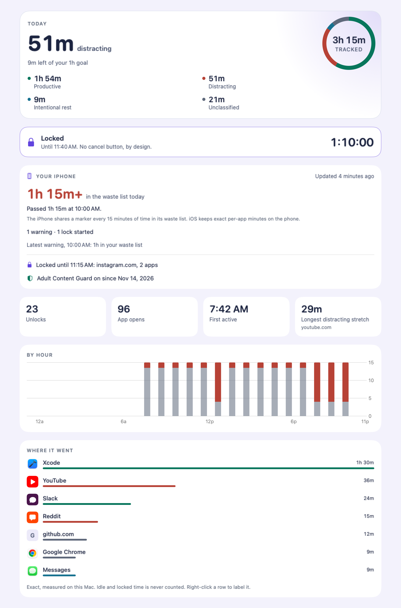
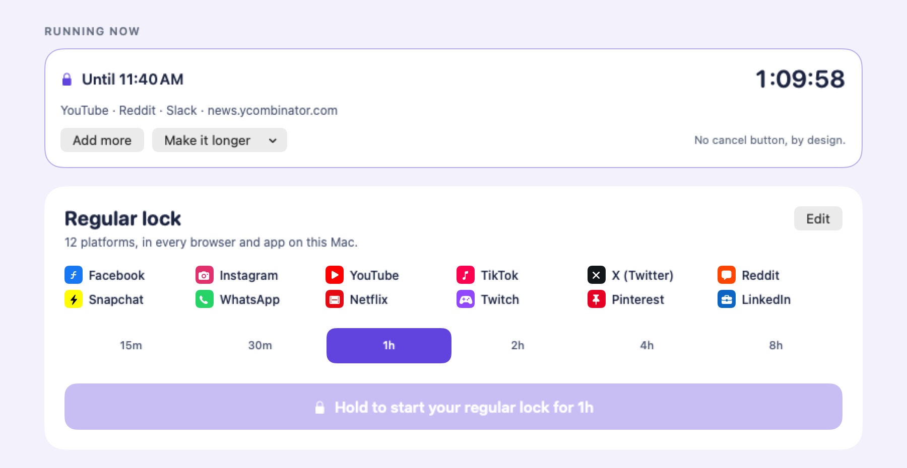
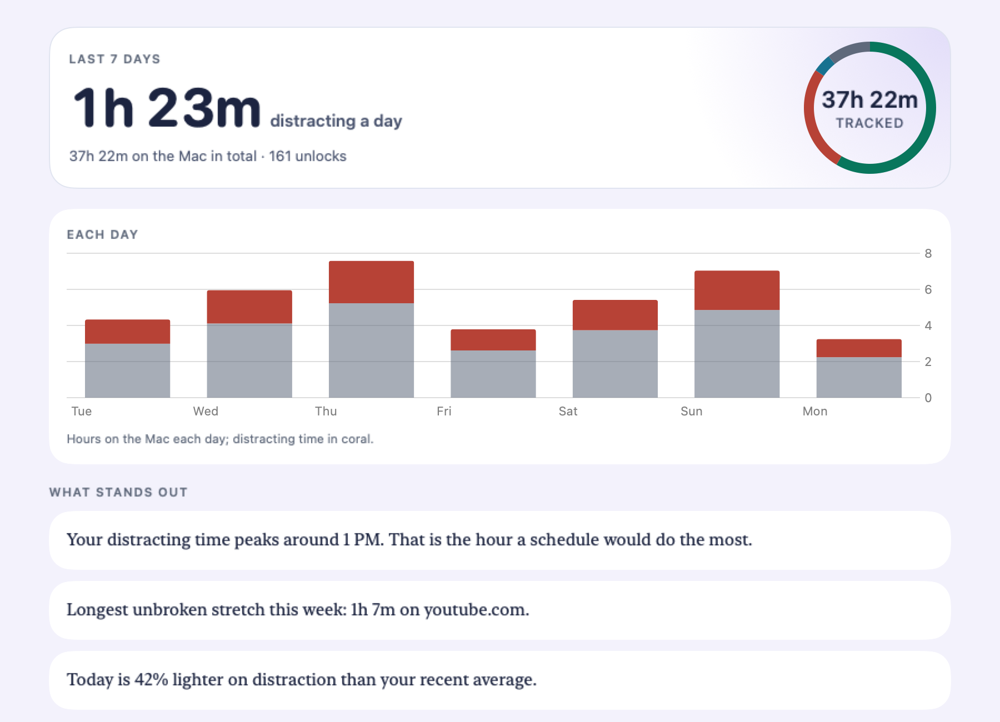
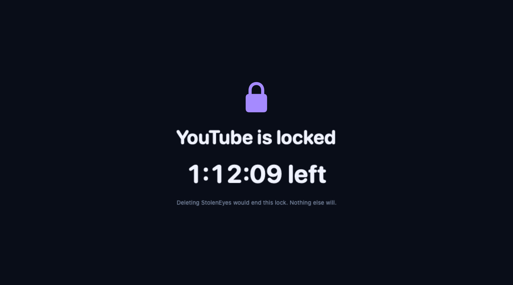

<div align="center">

# Stolen Glance

**See where your time goes. Lock what steals it, and mean it.**

An open-source screen-time app for iPhone and Mac. Its locks have no cancel button,
and its adult content guard has no off switch.

[](LICENSE)


[](CONTRIBUTING.md)

<picture>
  <source media="(prefers-color-scheme: dark)" srcset="docs/screenshots/mac-today-dark.png">
  
</picture>

</div>

---

## Why Stolen Glance

Screen Time tells you that you spent four hours on your phone. Then it offers an "Ignore limit"
button, and you press it. Every blocker you have tried has the same flaw: the person it is
protecting you from also knows the password.

Stolen Glance is built on a different promise:

- **A lock ends when its timer ends.** No cancel, no "15 more minutes", no passcode. Not in the
  app, not in the menu bar, not by restarting.
- **You decide once, with a clear head.** Start a lock, set a schedule or turn on the guard
  while you are calm. You can't undo it later in a weaker moment.
- **It shows you the truth.** It measures where your time actually went, sorts it into
  productive, distracting, rest and unclassified, and points out the patterns: the hour you
  slip, the app you check reflexively, the longest rabbit hole of the week.

There is exactly one way out, and we tell you up front so you never go looking for a loophole:
**deleting the app ends every lock**. On the Mac that also throws away your history. That
cost is deliberate.

## What it does

### On iPhone

- **Today and Insights.** Your day as a time balance with a goal, a focus streak, an hourly
  heatmap, and insights such as the "checking reflex" (lots of opens, few minutes) and
  notification pull. Platforms are grouped, so YouTube is one row whether you used the app or
  the site.
- **Hard locks.** Hold to lock apps and websites for a set time. It's add-only while it runs,
  and a custom shield shows the time left.
- **Schedules.** Lock evenings or work hours automatically. A schedule can only be removed
  while it is off.
- **Escalating warnings.** A nudge, then a firm reminder, then a full-screen intervention as
  your distracting time grows.
- **Adult Content Guard.** A permanent, one-way block of adult sites and any apps you choose.
  It lives in its own settings store, so no lock starting or ending can touch it.
- **Install window.** New apps can be installed only during a daily window. You can switch it
  on any time, but loosening it is allowed only on Friday at midday.
- **Nightly check-in.** "Did you win today?" with a winning streak.

### On Mac

<table>
<tr>
<td width="50%"></td>
<td width="50%"></td>
</tr>
<tr>
<td><b>Regular lock.</b> One hold locks your usual set, which starts as every social platform. Or build a one-off lock from platforms, sites and apps.</td>
<td><b>Insights.</b> Your week, your heaviest hours, and plain sentences about what stands out.</td>
</tr>
</table>

- **Exact time per app and per website**, including which site each browser tab was on.
  Idle and locked time is never counted.
- **Locks that hold in every browser.** A network filter blocks locked sites in Safari,
  Chrome, Firefox and every other app. A background helper closes locked apps the moment they
  open.
- **Adult Content Guard for Mac.** A large domain list, SafeSearch forced on Google, Bing,
  DuckDuckGo and YouTube, and the usual bypasses (encrypted DNS, QUIC, iCloud Private Relay)
  closed. The optional Screen Guard covers the screen when explicit images appear.
- **Connected devices.** The iPhone and Mac see each other's locks, guard and day through
  *your own* private iCloud database. Nothing in sync can end a lock or switch off a guard.

<p align="center">

</p>

All screenshots are rendered from built-in sample data (`StolenEyes --render-snapshots`), not from anyone's real usage.

## Privacy

- **No account, no Stolen Glance server, no analytics, no ads.**
- On iPhone, per-app usage stays inside Apple's Screen Time report extension. Even the app
  itself never sees the raw numbers.
- Connected devices sync through your own private iCloud database. The iPhone shares
  15-minute markers, never per-app minutes.
- Read the [privacy policy](https://mostafaelkabir.github.io/Prosper/privacy.html).

## Status

Stolen Glance is in **active development**. It is not on the App
Store or TestFlight yet. The Family Controls distribution entitlement is granted, and the App
Store listing is still being set up. The Mac app is development-signed. Until there's a public build,
the way to use it is to build it yourself. It takes about ten minutes, and the steps are below.

If you want a build without compiling it yourself,
[open an issue](https://github.com/mostafaelkabir/Prosper/issues/new) and say which device you
use. That tells us where to start.

## Build it yourself

You need a Mac with a recent Xcode, [XcodeGen](https://github.com/yonaskolb/XcodeGen), and,
for a real device, an Apple Developer account. The iPhone app's Screen Time features need the
Family Controls entitlement, which paid accounts get automatically for development.

```bash
git clone https://github.com/mostafaelkabir/Prosper.git
cd Prosper
brew install xcodegen
xcodegen generate        # project.yml is the source of truth
open Prosper.xcodeproj
```

- **iPhone Simulator:** run the `Prosper` scheme. The simulator cannot enforce locks or read
  Screen Time, so usage screens show sample data.
- **Your own iPhone:** replace the team ID `V9WJ9X99FX` and the `com.mostafa` identifier prefix
  with your own in `project.yml`, the `*.entitlements` files and the App Group / iCloud
  identifiers in `Prosper/Services` and `Packages/ProsperCore/Sources/ProsperCore/Sync`. Then
  run `xcodegen generate` again. (Moving these into one config file is a
  [good first contribution](CONTRIBUTING.md#good-first-contributions).)
- **Mac:** `bash scripts/install-mac.sh --without-filter` builds and installs the app and its
  helper with your local development certificate. Time tracking, app locks and tab closing
  work. Run `bash scripts/install-mac.sh` for the full build with the network filter. That
  needs an account that can provision Network Extension and System Extension capabilities.
  See [docs/mac/PLAN.md](docs/mac/PLAN.md).

Run the tests:

```bash
cd Packages/ProsperCore && swift test
```

```bash
xcodebuild -scheme ProsperMac test CODE_SIGNING_ALLOWED=NO
```

## How it's built

| Piece | What it is |
| --- | --- |
| `Prosper/` | iPhone app: SwiftUI, SwiftData, FamilyControls / ManagedSettings / DeviceActivity |
| `ProsperMonitor`, `ProsperShield`, `ProsperShieldAction`, `ProsperReport` | iPhone extensions: background monitor, block screen, its button, and the only place iOS reveals per-app usage |
| `ProsperMac/` | Mac app (UI only, product `StolenEyes.app`) |
| `ProsperMacAgent/` | Mac login-item helper: usage sampler, browser URL reader, app enforcer, shield, Screen Guard |
| `ProsperMacFilter/` | Mac system extension: content filter and DNS proxy |
| `Packages/ProsperCore` | Shared Swift package: rules, domain logic, sync, copy |
| `docs/` | Product site, privacy policy, Mac plan, device test scripts |

Everything runs on the device. There is no backend.

## Contributing

Stolen Glance is for anyone who has lost an evening to a feed and wants a tool that won't
negotiate. Contributions are very welcome: code, design, copy, testing on real devices, and
honest bug reports.

Read **[CONTRIBUTING.md](CONTRIBUTING.md)** first. It has the setup, the good first issues, and
the few rules that make this app what it is. The most important one is short: **no feature may
end a lock early or switch the guard off.**

## License

Stolen Glance is free software under the [GNU General Public License v3.0](LICENSE). You can use,
study, change and share it. If you distribute a modified version, it must stay open under the
same license.

<sub>Developed under the project name **Prosper**, which is why you will see that name in the code, the repository and the URLs.</sub>

Brand marks shown in the app (Facebook, YouTube, Reddit and the like) come from
[Simple Icons](https://simpleicons.org), whose files are CC0. The marks are
trademarks of their owners and are not covered by this project's license. The
app shows them only to identify the app or site you are locking or labelling.
